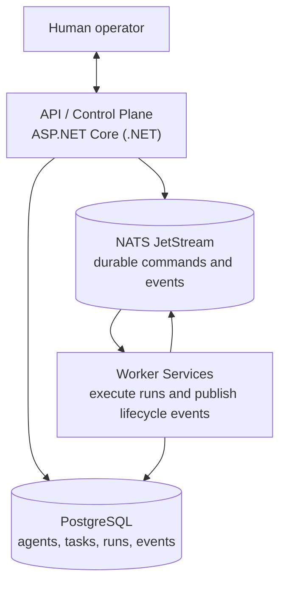
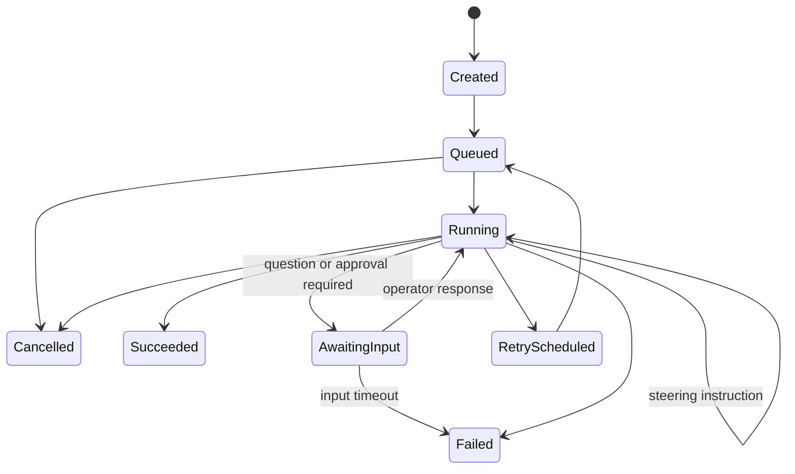

# Agent Platform

> A platform for operating long-running, message-driven AI agents: define an agent, give it work, observe its execution, and retain an auditable record of the result.

Agent Platform is an in-progress management and execution service built with **.NET**, **PostgreSQL**, and **NATS JetStream**. It is designed around the concerns that emerge once agents move beyond a single request/response: durable work queues, retries, execution state, human steering, run history, and operational visibility.

## Why this project?

Most agent demos focus on prompting. This project focuses on the platform around the prompt: the control plane that manages agents and work, and the execution plane that processes that work reliably.

The goal is to demonstrate pragmatic backend engineering rather than to present a production-ready hosted service. The public API and implementation will evolve as the platform takes shape.

## Intended capabilities

- Register and version agent definitions, including configuration and execution policy.
- Submit asynchronous tasks to a named agent.
- Schedule, dispatch, and track execution runs through explicit state transitions.
- Exchange durable messages with an agent before and during a run, including steering instructions, clarifications, and approvals.
- Deliver steering commands to active workers promptly while retaining an ordered, auditable conversation history.
- Expose a built-in platform MCP server so UI-created, explicitly authorised agents can manage approved project resources through tools.
- Deliver work to workers through durable JetStream streams and consumers.
- Retry transient failures with bounded attempts and back-off; surface terminal failures for review.
- Cancel queued or running work where the worker supports cooperative cancellation.
- Store execution metadata, output references, and an append-only event history in PostgreSQL.
- Expose health, readiness, metrics, and structured logs suitable for local observability.

## Architecture



The API owns durable business state in PostgreSQL. JetStream is used for asynchronous commands and lifecycle events, allowing workers to scale independently from the API. Consumers must be idempotent: a message can be delivered more than once, while a run should be executed at most once from the application's point of view.

## Core domain

| Concept | Description |
| --- | --- |
| **Project** | The resource and isolation boundary for agents and MCP servers. |
| **Agent** | A reusable logical definition; immutable versions hold its executable configuration. |
| **Agent instance** | A stateful, durable, single conversation thread pinned to one agent version. |
| **MCP server** | A project-scoped tool integration available only through an explicit agent-version grant. |
| **Platform administration agent** | A regular project agent, created in the UI, with explicit grants to platform-configuration tools. |
| **Task** | A request submitted to an agent, with input and execution policy. |
| **Run** | One concrete attempt to execute a task. |
| **Conversation** | The ordered, durable exchange between a human operator and an agent for a task or run. |
| **Steering message** | An operator instruction or response that changes, clarifies, pauses, or approves work in progress. |
| **Worker** | A stateless process that claims and performs runs. |
| **Event** | An immutable lifecycle record, such as `RunQueued`, `RunStarted`, or `RunCompleted`. |

An initial run lifecycle is as follows. A running agent can emit a question or checkpoint; it then waits for an operator response or a configured timeout. Operators can also steer a run without a prior request.



## Technology choices

| Area | Choice | Role |
| --- | --- | --- |
| Runtime | .NET / ASP.NET Core | HTTP API, background services, workers |
| Database | PostgreSQL | Source of truth for configuration and execution history |
| Messaging | NATS JetStream | Durable dispatch, consumer acknowledgements, event fan-out |
| Administration UI | Next.js (React) + TypeScript | Project administration, CRUD, agent-instance conversations, and run operations |
| Data access | Entity Framework Core *(planned)* | Migrations and persistence mapping |
| Observability | OpenTelemetry *(planned)* | Traces, metrics, and structured diagnostics |
| Local stack | Docker Compose | Reproducible API, worker, administration UI, PostgreSQL, and NATS environment |

## Design documents

- [High-level domain architecture](docs/design/001-high-level-domain-architecture.md) — project-scoped resources, agent definitions, MCP servers, and stateful agent instances.
- [Administration UI architecture](docs/design/002-administration-ui-architecture.md) — the Next.js-based administration application and its boundaries.
- [Platform administration agent](docs/design/003-platform-administration-agent.md) — a UI-created agent that configures its project through explicitly granted MCP tools.

## Repository status

This repository is at the foundation stage. It includes an initial .NET solution, API and worker hosts, a Next.js administration UI shell, and local PostgreSQL/NATS infrastructure. Persistence, message handling, authentication, and feature endpoints are the next implementation stages.

## Project layout

```text
apps/
  agent-platform-admin/         Next.js administration UI
  agent-platform-services/
    src/
      AgentPlatform.Api/        HTTP endpoints and control-plane services
      AgentPlatform.Application/ Use cases, contracts, and domain orchestration
      AgentPlatform.Domain/      Domain model and business rules
      AgentPlatform.Infrastructure/ PostgreSQL and NATS implementations
      AgentPlatform.Worker/      Background execution host
tests/
  AgentPlatform.UnitTests/
  AgentPlatform.IntegrationTests/
docker-compose.yml              Local application and infrastructure stack
run.sh                          Builds images and starts the local stack
AGENTS.md                       Repository instructions for coding agents
docs/design/                    Architecture and design records
```

## Local development

Prerequisites:

- Docker with Docker Compose

Create your local configuration from the tracked template, then update any values required for your machine. `.env` is deliberately ignored by Git.

```bash
cp example.env .env
```

Build the API, worker, and administration UI images, then start the complete local stack:

```bash
./run.sh -d
docker compose ps
```

The configured host ports are defined in `.env`; the template exposes the administration UI at `http://localhost:3010` and PostgreSQL at `localhost:5420`.

For host-based development, install the .NET SDK and Node.js as well. The backend projects are under `apps/agent-platform-services/src`:

```bash
dotnet restore
dotnet test
dotnet run --project apps/agent-platform-services/src/AgentPlatform.Api
dotnet run --project apps/agent-platform-services/src/AgentPlatform.Worker

cd apps/agent-platform-admin
npm install
npm run dev
```

Docker Compose passes the .NET connection and NATS settings from `.env` as standard environment variables. For host-based backend development, provide equivalent environment variables through your preferred local-secret mechanism.

Persistent local data is held in named Docker volumes. Stop the stack with `docker compose down`; include `--volumes` only when you intentionally want to discard local data.

Never commit credentials or provider keys. Keep them in the ignored `.env` file or a local secret manager.

## Engineering principles

- **Durability first:** state changes are recorded before work is considered accepted.
- **Idempotency by design:** handlers tolerate redelivery and retry safely.
- **Explicit state:** lifecycle transitions are validated and observable.
- **Separation of concerns:** API/control-plane responsibilities remain separate from execution workers.
- **Operability:** failures should be diagnosable from logs, metrics, traces, and persisted events.

## Roadmap

- [ ] Solution scaffold, local Docker Compose stack, and configuration validation
- [ ] Agent and task APIs with PostgreSQL migrations
- [ ] Transactional outbox and JetStream dispatch
- [ ] Worker execution host with retries, leases, and cancellation
- [ ] Durable operator conversations, run checkpoints, and in-flight steering
- [ ] Run history, filtering, and event timeline endpoints
- [ ] OpenTelemetry instrumentation and integration tests
- [ ] Example agent implementation and end-to-end demo

## License

A license will be selected before the first public release.
