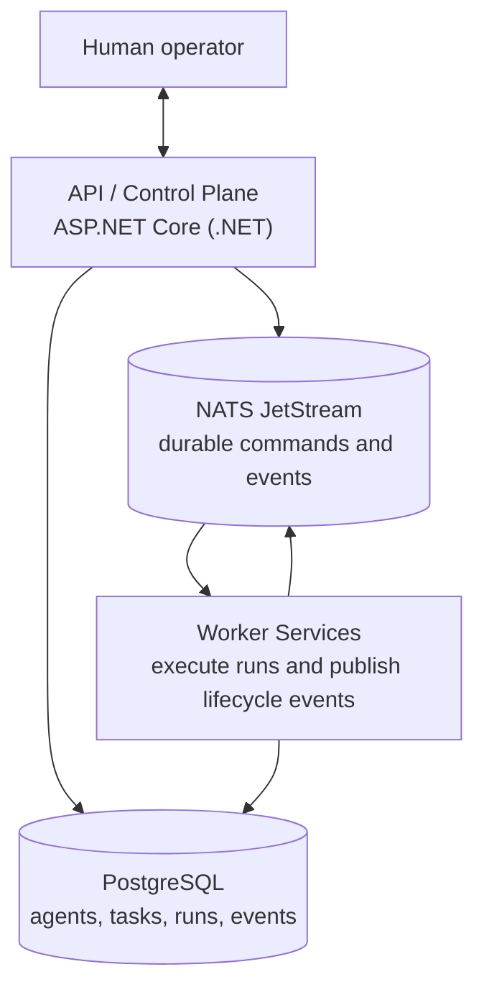
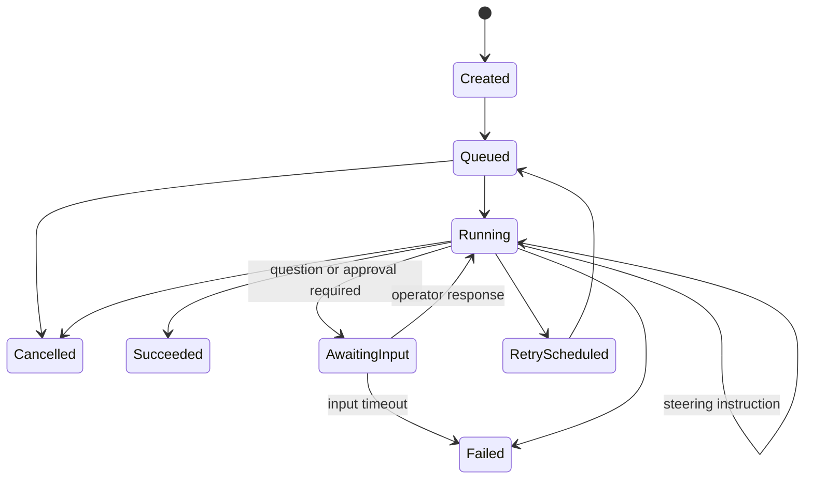

# Agent Platform

> A platform for operating long-running, message-driven AI agents: define an agent, give it work, observe its execution, and retain an auditable record of the result.

Agent Platform is an in-progress management and execution service built with **.NET**, **PostgreSQL**, and **NATS JetStream**. It is designed around the concerns that emerge once agents move beyond a single request/response: durable work queues, retries, execution state, human steering, run history, and operational visibility.

## Why this project?

Most agent demos focus on prompting. This project focuses on the platform around the prompt: the control plane that manages agents and work, and the execution plane that processes that work reliably.

The goal is to demonstrate pragmatic backend engineering rather than to present a production-ready hosted service. The public API and implementation will evolve as the platform takes shape.

## Intended capabilities

- Register and version agent definitions, including configuration and execution policy.
- Submit asynchronous tasks to a named agent.
- Schedule, dispatch, and track execution runs through explicit state transitions.
- Exchange durable messages with an agent before and during a run, including steering instructions, clarifications, and approvals.
- Deliver steering commands to active workers promptly while retaining an ordered, auditable conversation history.
- Expose a built-in platform MCP server so UI-created, explicitly authorised agents can manage approved project resources through tools.
- Deliver work to workers through durable JetStream streams and consumers.
- Retry transient failures with bounded attempts and back-off; surface terminal failures for review.
- Cancel queued or running work where the worker supports cooperative cancellation.
- Store execution metadata, output references, and an append-only event history in PostgreSQL.
- Expose health, readiness, metrics, and structured logs suitable for local observability.

## Architecture



The API owns durable business state in PostgreSQL. JetStream is used for asynchronous commands and lifecycle events, allowing workers to scale independently from the API. Consumers must be idempotent: a message can be delivered more than once, while a run should be executed at most once from the application's point of view.

## Core domain

| Concept | Description |
| --- | --- |
| **Project** | The resource and isolation boundary for agents and MCP servers. |
| **Agent** | A reusable logical definition; immutable versions hold its executable configuration. |
| **Agent thread** | A stateful, durable conversation pinned to one agent version. |
| **MCP server** | A project-scoped tool integration available only through an explicit agent-version grant. |
| **Platform administration agent** | A regular project agent, created in the UI, with explicit grants to platform-configuration tools. |
| **Task** | A request submitted to an agent, with input and execution policy. |
| **Run** | One concrete attempt to execute a task. |
| **Conversation** | The ordered, durable exchange between a human operator and an agent for a task or run. |
| **Steering message** | An operator instruction or response that changes, clarifies, pauses, or approves work in progress. |
| **Worker** | A stateless process that claims and performs runs. |
| **Event** | An immutable lifecycle record, such as `RunQueued`, `RunStarted`, or `RunCompleted`. |

An initial run lifecycle is as follows. A running agent can emit a question or checkpoint; it then waits for an operator response or a configured timeout. Operators can also steer a run without a prior request.



## Technology choices

| Area | Choice | Role |
| --- | --- | --- |
| Runtime | .NET / ASP.NET Core | HTTP API, background services, workers |
| Database | PostgreSQL | Source of truth for configuration and execution history |
| Messaging | NATS JetStream | Durable dispatch, consumer acknowledgements, event fan-out |
| Administration UI | Next.js (React) + TypeScript | Project administration, CRUD, agent-thread conversations, and run operations |
| Data access | Entity Framework Core | PostgreSQL migrations and persistence mapping |
| Observability | OpenTelemetry *(planned)* | Traces, metrics, and structured diagnostics |
| Local stack | Docker Compose | Reproducible API, worker, administration UI, PostgreSQL, and NATS environment |

## Design documents

- [High-level domain architecture](docs/design/001-high-level-domain-architecture.md) — project-scoped resources, agent definitions, MCP servers, and stateful agent threads.
- [Administration UI architecture](docs/design/002-administration-ui-architecture.md) — the Next.js-based administration application and its boundaries.
- [Platform administration agent](docs/design/003-platform-administration-agent.md) — a UI-created agent that configures its project through explicitly granted MCP tools.
- [Agent consumer specification](docs/agent-consumer-specification.md) — integrate a coding agent with chat threads and signed webhook events.
- [Knowledge Base microservice specification](docs/knowledge-base-microservice-specification.md) — proposed project-scoped documents, asynchronous pgvector indexing, and explicitly granted MCP retrieval.

## Repository status

Platform administrators can discover the built-in platform MCP tool catalog through the Clerk-authenticated `GET /api/platform-mcp/tools` endpoint (proxied by the admin application). Agent tool calls continue to use the agent API key and explicit grants.

This repository is at the foundation stage. It includes an initial .NET solution, separate frontend and application-facing thread API hosts, a worker host, a Next.js administration UI, PostgreSQL/NATS infrastructure, project/agent CRUD, project-scoped MCP server configuration, and project webhooks with transactional delivery retries. The built-in platform MCP endpoint can list projects, retrieve a project with its agents, MCP servers, and webhooks, and create, update, or delete those resources through the control-plane services. An agent may select one platform LLM configuration and receives MCP access only through explicit, persisted per-tool grants to servers in its project. The UI marks an agent without an LLM as misconfigured. MCP server tool definitions are cached durably for each server's configured TTL and can be cleared from the administration UI. Agent threads can now be triggered with an initial prompt; their durable, cursor-paginated timeline records messages and tool calls. Operators may send a queued message (one pending message at a time) or a steering message, which records a cooperative cancellation request for an active execution. Every stored message and tool call creates an `agent.message` or `agent.tool_call` webhook delivery in the same database transaction. Clerk protects the administration UI and browser-facing API endpoints. Authenticated Clerk users are tracked as accounts in PostgreSQL. Worker-side model invocation and MCP tool execution remain the next implementation stages.

Successful LLM completions are retained as 15-minute usage buckets. Each completion increments independent platform-, project-, agent-, and LLM-configuration-level aggregates. A bucket reports `callCount`, `inputTokens`, `cachedInputTokens`, `outputTokens`, `reasoningTokens`, and provider-reported `totalTokens`; token fields are zero when a compatible provider omits its `usage` object. Read the buckets with optional half-open `from`/`to` timestamps:

- `GET /api/usage/platform`
- `GET /api/projects/{projectId}/usage`
- `GET /api/projects/{projectId}/agents/{agentId}/usage`
- `GET /api/llm-configurations/{id}/usage`

The application-facing thread API, exposed locally at `http://localhost:8081`, requires an agent API key in `Authorization: Bearer <key>`. Keys are created, displayed once, and revoked from the selected agent's **API keys** control in the administration UI; each key is restricted to that agent's own threads. It provides:

- `POST /api/projects/{projectId}/agents/{agentId}/threads` with `{ "initialPrompt": "..." }`
- `GET /api/projects/{projectId}/agent-threads/{threadId}`
- `GET /api/projects/{projectId}/agent-threads/{threadId}/timeline?afterSequence={cursor}&limit={1..100}`
- `POST /api/projects/{projectId}/agent-threads/{threadId}/messages` with `{ "content": "...", "delivery": "Queued" | "Steering" }`
- `GET /api/projects/{projectId}/agent-threads/`
- `DELETE /api/projects/{projectId}/agent-threads/{threadId}`

## Project layout

```text
apps/
  agent-platform-admin/         Next.js administration UI
  agent-platform-services/
    src/
      AgentPlatform.Api/        Platform HTTP endpoints and control-plane services
      AgentPlatform.KnowledgeBaseApi/ Dedicated knowledge-base HTTP microservice
      AgentPlatform.Application/ Use cases, contracts, and domain orchestration
      AgentPlatform.Domain/      Domain model and business rules
      AgentPlatform.Infrastructure/ PostgreSQL and NATS implementations
      AgentPlatform.Worker/      Background execution host
      AgentPlatform.EmbeddingWorker/ Independent knowledge-base indexing host
tests/
  AgentPlatform.UnitTests/
  AgentPlatform.IntegrationTests/
docker-compose.yml              Local application and infrastructure stack
run.sh                          Builds images and starts the local stack
AGENTS.md                       Repository instructions for coding agents
docs/design/                    Architecture and design records
```

## Local development

Prerequisites:

- Docker with Docker Compose

Create your local configuration from the tracked template, then update any values required for your machine. `.env` is deliberately ignored by Git.

```bash
cp example.env .env
```

Set `NEXT_PUBLIC_CLERK_PUBLISHABLE_KEY`, `CLERK_SECRET_KEY`, and `CLERK_JWT_ISSUER` in `.env` for one Clerk instance. The issuer is the instance URL (for example, `https://example.clerk.accounts.dev`). The administration UI forwards Clerk session tokens to the control-plane API, where they are validated and used to create/update durable account records. Never commit the secret key.

The control plane is deny-by-default. Set `ADMINISTRATION__BOOTSTRAP_ADMIN_CLERK_USER_IDS` to one or more comma-separated Clerk user IDs before the first administrator signs in. Bootstrap identities are persisted as administrators; administrators may then list accounts and grant or revoke administrator status through `PUT /api/accounts/{clerkUserId}/administrator` with `{ "isAdmin": true | false }`. All non-administrator accounts receive `403` from control-plane endpoints.

To enable the dedicated administration chat, create a normal project agent named Jim, grant it the required platform MCP tools, create an API key for it in **Agents → API keys**, then set its UUID as `JIM_AGENT_ID` and the generated key as `JIM_AGENT_API_KEY` in `.env`. The API key is server-only and must not use a `NEXT_PUBLIC_` prefix. Rebuild the administration image after changing either value.

Build the API, worker, and administration UI images, then start the complete local stack:

```bash
./run.sh -d
docker compose ps
```

### Knowledge bases

The dedicated `knowledge-base-api` container exposes project-scoped knowledge bases at
`/api/projects/{projectId}/knowledge-bases`. Creating or replacing a document
persists its source revision, indexing job, and transactional outbox intent
before returning `202 Accepted`. The independently deployed `embedding-worker`
Compose service claims those durable jobs and writes the replacement chunk set
atomically. PostgreSQL uses the `pgvector/pgvector:pg17-trixie` image; existing
local PostgreSQL volumes should be recreated only if they do not have the
required `vector` extension.

Its MCP endpoint is `POST /mcp` on the service. It uses the calling agent API
key, requires an explicit `knowledge_base.search` grant, and derives the
project scope from that key.

The administration UI is exposed through the external Traefik gateway at
`https://agent-platform.${DNS_SUFFIX}`.
Set `DNS_SUFFIX` in the environment used to run Compose. PostgreSQL remains
published on the host at `localhost:${POSTGRES_PORT}` (5420 in the provided
`.env`); the application APIs and administration UI are available only on the
internal Compose networks.

### External MCP servers

The API and worker also join the external Docker network named by `MCP_NETWORK_NAME` (default: `agent-platform-mcp`). Create it once before starting the stack:

```bash
docker network create agent-platform-mcp
```

Attach each separately deployed MCP server container to that network. Configure its project MCP-server endpoint using that container's network DNS name, for example `http://my-mcp-server:3000/mcp`. MCP server ports do not need to be published to the host unless another host-side client needs access.

Before configuring an LLM, webhook, or MCP server, allowlist its hostname in `.env`. `OUTBOUND_HTTP__ALLOWED_LLM_HOSTS`, `OUTBOUND_HTTP__ALLOWED_WEBHOOK_HOSTS`, and `OUTBOUND_HTTP__ALLOWED_MCP_HOSTS` are comma-separated and deny all destinations by default. All LLM and webhook destinations must be public HTTPS endpoints. An internal HTTP MCP hostname must appear in both `OUTBOUND_HTTP__ALLOWED_MCP_HOSTS` and `OUTBOUND_HTTP__INTERNAL_MCP_HOSTS`; use this narrowly for the named Docker MCP network.

For host-based development, install the .NET SDK and Node.js as well. The backend projects are under `apps/agent-platform-services/src`:

```bash
dotnet restore
dotnet test
dotnet run --project apps/agent-platform-services/src/AgentPlatform.Api --urls http://localhost:8080
dotnet run --project apps/agent-platform-services/src/AgentPlatform.AgentApi --urls http://localhost:8081
dotnet run --project apps/agent-platform-services/src/AgentPlatform.Worker

cd apps/agent-platform-admin
npm install
npm run dev
```

The browser accesses projects through same-origin Next.js route handlers; the
administration container forwards control-plane calls to the frontend API and
thread interactions to the thread API over the internal Compose network. For
host-based backend development, provide equivalent environment variables through
your preferred local-secret mechanism.

Persistent local data is held in named Docker volumes. Stop the stack with `docker compose down`; include `--volumes` only when you intentionally want to discard local data.

Never commit credentials or provider keys. Keep them in the ignored `.env` file or a local secret manager.

## Engineering principles

- **Durability first:** state changes are recorded before work is considered accepted.
- **Idempotency by design:** handlers tolerate redelivery and retry safely.
- **Explicit state:** lifecycle transitions are validated and observable.
- **Separation of concerns:** API/control-plane responsibilities remain separate from execution workers.
- **Operability:** failures should be diagnosable from logs, metrics, traces, and persisted events.

## Roadmap

- [ ] Solution scaffold, local Docker Compose stack, and configuration validation
- [ ] Agent and task APIs with PostgreSQL migrations
- [ ] Transactional outbox and JetStream dispatch
- [ ] Worker execution host with retries, leases, and cancellation
- [ ] Durable operator conversations, run checkpoints, and in-flight steering
- [ ] Run history, filtering, and event timeline endpoints
- [ ] OpenTelemetry instrumentation and integration tests
- [ ] Example agent implementation and end-to-end demo

## License

A license will be selected before the first public release.
