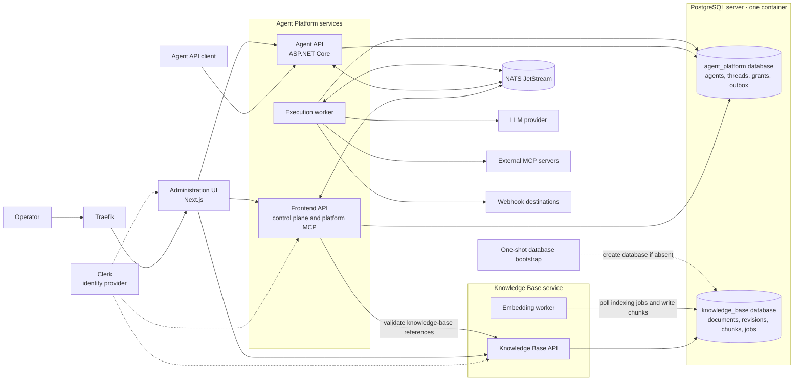

# System architecture

This diagram describes the current application containers and their principal connections. Dashed lines represent external dependencies or startup provisioning.

The two databases share a PostgreSQL server but have separate service ownership. Project IDs in the knowledge-base database and knowledge-base IDs in platform grants are references; neither database uses foreign keys into the other. The knowledge-base worker currently polls its own durable indexing jobs; the diagram does not imply that it consumes JetStream messages.
