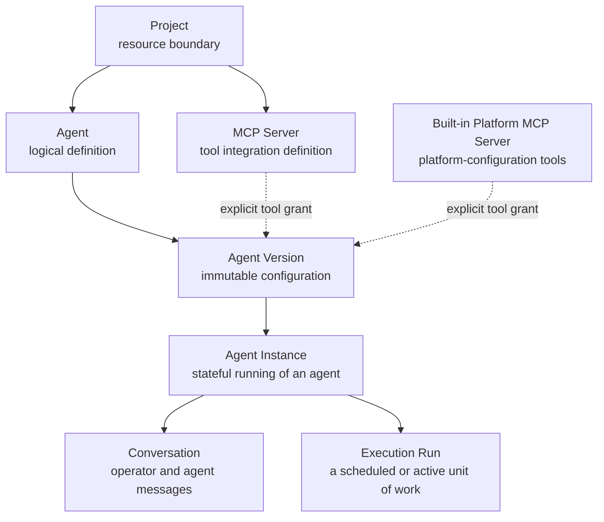
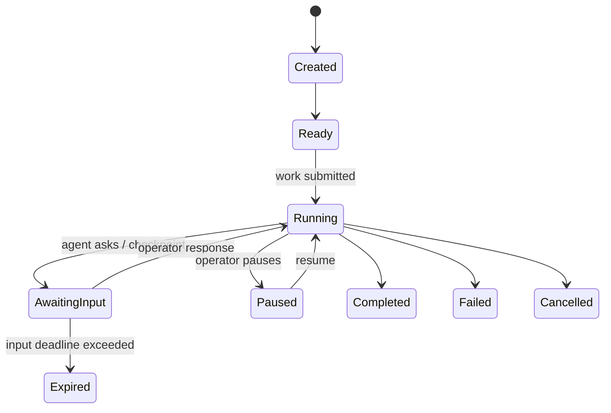

# High-Level Domain Architecture

- **Status:** Proposed
- **Date:** 2026-11-08
- **Decision:** Establish projects as the resource boundary. Model agent definitions as immutable versions and agent instances as stateful, single-threaded conversations pinned to one version. Grant tools explicitly and publish lifecycle events to configured NATS streams.

## Context

The platform needs to organise agent-related resources, execute agents asynchronously, and allow an operator to converse with an agent while it is running. A single agent definition is not enough to represent this: definitions should be reusable, while conversations, in-progress work, and runtime state belong to one particular execution.

The platform also needs to associate Model Context Protocol (MCP) servers with the agents that may use them, without making those servers global by default. Applications need a reliable way to learn about changes without querying the primary database, including by pulling events from NATS JetStream consumers.

## Decision

The initial ownership hierarchy is:



An agent version may only use MCP servers from its own project, or the built-in platform MCP server, and only when a specific tool grant exists. Project resources cannot be shared across projects in the first iteration. The built-in server applies the calling agent's project scope to every operation.

## Domain model

| Entity | Responsibility | Key relationships |
| --- | --- | --- |
| **Project** | Groups resources and establishes the authorisation and isolation boundary. | Owns agents and MCP servers. |
| **Agent** | A stable logical identity for a class of work. | Belongs to one project; has many immutable versions. |
| **Agent version** | An immutable snapshot of an agent's instructions, model configuration, tool grants, and event delivery configuration. | Belongs to one agent; creates many agent instances. |
| **MCP server** | A project-scoped definition of an MCP-compatible tool server and its connection configuration. | Belongs to one project; may be enabled for eligible agents in that project. |
| **Built-in platform MCP server** | A platform-owned MCP server that exposes platform-configuration tools. | Is globally operated but authorises every call within the calling agent's project scope. |
| **Tool grant** | An explicit permission for an agent version to invoke an MCP server, optionally constrained to named tools. | Connects one agent version to one MCP server in the same project. |
| **Agent instance** | The durable, stateful identity for one running or resumable use of an agent. It holds runtime configuration, state, and exactly one conversation thread. | Belongs to one agent version; owns one conversation and many runs. |
| **Conversation** | An ordered, durable transcript of human and agent messages. | Has a one-to-one relationship with an agent instance. |
| **Execution run** | A concrete attempt to perform work for an agent instance. | Belongs to one agent instance; emits immutable lifecycle events. |

### Agent, version, and agent instance

An **agent** is a stable logical identity and is safe to reuse. Its mutable metadata (such as a display name) is separate from executable configuration.

An **agent version** is an immutable executable configuration. Publishing a new version creates a new record rather than changing an existing one. The version captures instructions, model configuration, permitted MCP tools, and NATS event delivery targets. An existing instance is never changed to use a later version implicitly.

An **agent instance** is created when a caller starts a stateful interaction or execution. It pins one agent version and owns exactly one conversation thread. It records runtime state such as its status, model/session references, and current checkpoint. It is the addressable target for a human's steering message.

This separation allows multiple independent instances of the same agent version to run concurrently, resume a paused interaction, and retain an audit trail without mutating the configuration used by existing or future instances.

## Ownership and isolation rules

1. Every agent and MCP server has exactly one `project_id`.
2. Every agent version has an `agent_id`; it is immutable after publication.
3. Every agent instance has an `agent_version_id`; its project is derived from that version and must be recorded or queryable consistently for isolation checks.
4. An agent version can reference only MCP servers with the same `project_id`, or the built-in platform MCP server, through explicit tool grants. No tool is available by default.
5. An agent instance owns exactly one conversation. A conversation, steering message, run, and event can only be created for an existing agent instance.
6. API routes and worker messages must carry enough identifiers to validate project ownership before performing an operation.
7. Deletion should initially be logical (archival) for agents, versions, instances, and MCP servers so audit history remains intact.

## Lifecycle



`AgentInstance` state describes the durable interaction as a whole. A run has a separate attempt lifecycle (`Queued`, `Running`, `Succeeded`, `Failed`, and retry states). An instance can have several runs over its lifetime—for example, after new operator input or when resuming paused work.

## Messaging implications

PostgreSQL remains the source of truth for project resources, agent instances, conversations, and state transitions. JetStream transports commands and events but does not replace persisted state.

Each agent version declares zero or more **named event stream targets**. A target names a JetStream stream that has been provisioned for the project and the subject pattern used for events. When a relevant state change is committed, the outbox publisher emits a versioned event envelope to each configured target. Applications create durable pull consumers for those streams and poll on their own cadence, acknowledging messages only after processing them.

The platform must validate that a configured stream belongs to the same project and that the subject is accepted by that stream. An agent cannot publish events to an arbitrary cross-project stream.

Example subjects (names are provisional):

```text
agent-platform.project.{projectId}.instance.{instanceId}.run.requested
agent-platform.project.{projectId}.instance.{instanceId}.steering.requested
agent-platform.project.{projectId}.agent.{agentId}.event.{eventType}
```

Event envelopes should include an event identifier, schema version, project ID, agent ID, agent version ID, instance ID when applicable, event type, timestamp, and correlation/causation identifiers. Payloads must avoid secrets and use stable schema versions.

Before publishing a run, steering command, or external event, the API persists the relevant state transition and outbox record in the same database transaction. Workers validate the instance's current state, pinned version, tool grants, and project ownership; they process commands idempotently and persist the outcome before acknowledging delivery.

## Initial API shape

The eventual HTTP API should follow the hierarchy where it helps callers understand scope:

```text
/projects
/projects/{projectId}/agents
/projects/{projectId}/agents/{agentId}/versions
/projects/{projectId}/mcp-servers
/projects/{projectId}/nats-streams
/projects/{projectId}/agents/{agentId}/instances
/projects/{projectId}/agent-instances/{instanceId}
/projects/{projectId}/agent-instances/{instanceId}/messages
/projects/{projectId}/agent-instances/{instanceId}/runs
```

Exact endpoint and payload design is deferred; this section documents ownership, not a committed REST contract.

## Consequences

### Benefits

- Resource ownership and authorisation checks have a clear project boundary.
- Agent definitions remain reusable, while versions make configuration reproducible.
- Operators have a stable target for conversation and steering even across multiple runs.
- Run history and conversation history can be retained independently and joined through the instance.
- Applications can poll durable JetStream consumers instead of repeatedly querying the API for changes.
- Future project-level settings—members, budgets, secrets, quotas, and audit policy—have a natural home.

### Costs

- More entities and foreign-key checks are required than in a simple task queue.
- Workers must account for stale or superseded steering commands.
- Instance state and run state must be coordinated carefully without duplicating their responsibilities.
- Event target provisioning, stream retention, and event-schema compatibility need operational governance.

## Open questions

- Which runtime state is platform-owned and persisted versus provider-specific and stored as an opaque checkpoint?
- What retention period and redaction controls apply to conversations and tool outputs?
- What fields, if any, may be changed on a draft agent version before it is published?
- Which built-in platform MCP operations should be available in the first release?
- Who provisions project event streams, and what naming, retention, and access-control policy applies?
- Should event targets receive every lifecycle event, or support an explicit event-type filter?
