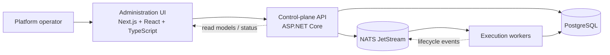

# Administration UI Architecture

- **Status:** Accepted
- **Date:** 2026-11-08
- **Decision:** Build the administration UI as a separate **Next.js (App Router) application using React and TypeScript**.

## Context

The platform needs a human-facing UI for project administration and CRUD operations: projects, agents, immutable agent versions, MCP servers, explicit tool grants, event-stream targets, agent threads, conversations, and execution runs. It must also make in-flight agent steering and platform-administration-agent setup understandable and safe.

The UI should use a current, well-supported frontend stack while keeping the .NET API, PostgreSQL, and NATS-based execution platform as the system of record and core business implementation.

## Decision

Use **Next.js with the App Router, React, and TypeScript** for the web application, located at `apps/agent-platform-admin`.

Use the .NET API as the sole business-system backend. The UI must not connect directly to PostgreSQL or NATS. Next.js may use server-side route handlers as a backend-for-frontend boundary for browser-session concerns, but it must delegate domain operations to the .NET API rather than duplicate domain logic.

The UI styling and component work should use Tailwind CSS and accessible, composable primitives. A design system is introduced only as components are needed; do not adopt a large component library merely for CRUD scaffolding.

## Why Next.js

Next.js provides file-based routing, server and client rendering boundaries, TypeScript support, and patterns for accessible forms, loading/error states, and authenticated applications. Its App Router uses current React capabilities, including Server Components and Suspense, and supports TypeScript as a first-class setup. [Next.js App Router documentation](https://nextjs.org/docs/app) and [TypeScript documentation](https://nextjs.org/docs/app/api-reference/config/typescript)

React and Next.js have broad adoption in the web ecosystem. The 2025 Stack Overflow survey identifies React and Next.js among the frameworks Node.js developers want to use. [Stack Overflow Developer Survey 2025](https://survey.stackoverflow.co/2025/technology)

## Responsibilities



| Layer | Owns | Does not own |
| --- | --- | --- |
| **Administration UI** | User interaction, navigation, form validation feedback, view state, optimistic UX where safe, and accessible presentation. | Business-state authority, direct database access, or direct NATS consumption. |
| **.NET API** | Authorisation, validation, domain commands, query models, audit decisions, and publishing work/events through the outbox. | Browser-only presentation state. |
| **Workers** | Execution, agent-provider interaction, tool invocation, and durable execution outcomes. | UI state or browser-session logic. |

## Initial information architecture

```text
/projects
/projects/:projectId/overview
/projects/:projectId/agents
/projects/:projectId/agents/:agentId
/projects/:projectId/agents/:agentId/versions/:versionId
/projects/:projectId/mcp-servers
/projects/:projectId/event-streams
/projects/:projectId/threads
/projects/:projectId/threads/:threadId
/projects/:projectId/threads/:threadId/conversation
/projects/:projectId/threads/:threadId/runs
```

The thread detail page is the operator workspace. It presents the single conversation, current thread and run state, available steering actions, tool activity, and an event timeline. A steering action must display whether it is queued, accepted, rejected, superseded, or expired; it cannot be represented as an untracked chat message.

## Data and interaction patterns

- Fetch read models from the .NET API; do not reconstruct domain state from raw NATS messages in the browser.
- Make all mutations explicit commands with a visible pending, success, and error state.
- Send a client-generated idempotency key for mutation requests where the API supports one, especially for starting runs and sending steering instructions.
- Refresh thread status after mutations. The initial version may poll a status endpoint; a later design may add API-mediated Server-Sent Events or WebSockets for live updates.
- Render server data where it reduces client JavaScript and use client components only for interactive behaviour such as forms, filtering, and the conversation composer.
- Keep access tokens and service credentials out of client-side code. The authentication and authorisation design is intentionally deferred.

## Project conventions

- Enable TypeScript strict mode, linting, formatting, and automated accessibility checks.
- Prefer feature-oriented organisation (for example, `features/agents`, `features/threads`) over a single global component directory.
- Define API request/response types in a generated or explicitly versioned client package; do not duplicate ungoverned shapes across pages.
- Treat agent instructions, tool arguments/results, and conversation content as potentially sensitive. Escape rendered text, redact sensitive fields, and avoid logging payloads in the browser.
- Support keyboard navigation, visible focus, labelled controls, and status announcements for asynchronous actions.

## Consequences

### Benefits

- A widely used frontend stack complements the .NET backend rather than replacing it.
- React and TypeScript make complex operator interactions and stateful forms straightforward to organise.
- The UI has a clean API boundary and remains independently deployable.
- The application can evolve from polling to live updates without exposing NATS directly to browsers.

### Costs

- The repository will contain both .NET and TypeScript toolchains.
- Next.js adds a Node.js runtime and operational surface in addition to the .NET API.
- API contracts must be managed deliberately to avoid frontend/backend drift.

## Deferred decisions

- Authentication provider and project-level role model.
- Whether to use an API-generated TypeScript client, OpenAPI client generation, or a hand-maintained typed SDK.
- The live-update transport and reconnection behaviour.
- The interface for creating a project administration agent from a guided template.
- Visual brand, component library choice, and theming.
