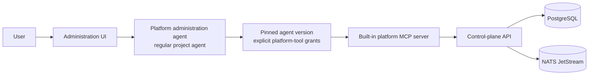

# Platform Administration Agent

- **Status:** Accepted
- **Date:** 2026-11-08
- **Decision:** Let users create a regular project agent in the UI and grant it selected tools from the platform's built-in MCP server so it can configure that project.

## Context

The platform needs to be configurable through natural-language interaction as well as forms. For example, a user may want to ask an agent to create a new draft agent, configure an MCP server, create an event target, or start a thread.

The intent is not to introduce a privileged control-plane component or a separate kind of agent. The configuration assistant must be a normal agent created and managed inside the platform, visible alongside other agents in the project's UI.

## Decision

The platform exposes a **built-in platform MCP server** that provides platform-configuration tools. A user creates a **platform administration agent** from the UI in the same way as any other agent: it has an agent definition, immutable versions, threads, a single conversation per thread, and explicit tool grants.

The administration agent is not a distinct domain entity or security principal. It is a conventional project agent whose version includes grants to selected built-in platform MCP tools. The UI may offer a guided template that creates the agent and a safe initial grant set, but the resulting resources follow the normal agent model.

## UI workflow

1. A user selects **Create administration agent** in a project.
2. The UI creates a normal agent and draft version using a guided template.
3. The user selects which built-in platform tools the version may invoke.
4. The UI publishes the version and starts a thread when the user begins a conversation.
5. The user and agent converse in the thread's single conversation; the agent invokes only its granted tools.
6. Configuration results appear in the conversation, resource views, audit timeline, and configured NATS event streams.

The UI must make the agent's grants clear before it is published and show tool activity and outcomes in the thread workspace.

## Built-in MCP tools

The built-in MCP server is a normal tool provider from the agent's perspective. Initial tool groups may include:

| Tool group | Example operations |
| --- | --- |
| **Project read** | Read project metadata; list agents, threads, MCP servers, and event targets. |
| **Agent configuration** | Create agents; create or edit draft versions; list versions. |
| **MCP configuration** | Create or update project MCP-server definitions; validate connection metadata. |
| **Threads and runs** | Create agent threads; submit work; pause, resume, or cancel threads. |
| **Event targets** | List and configure project event-stream targets. |

Tool grants are still explicit and deny-by-default. The first release must exclude tools that let an agent enlarge its own effective access: it cannot grant itself a new tool, edit the version pinned by its current thread, or read stored secret values.

## Authorisation and execution

1. The worker identifies the calling agent thread and its pinned agent version.
2. The built-in MCP server validates that the requested tool is explicitly granted on that version.
3. It derives the project from the version; tool arguments cannot select another project.
4. It calls the control-plane application layer, which applies normal validation and authorisation rules.
5. The application layer persists the change and outbox entry atomically, then publishes resulting commands or events through NATS.
6. The tool result and audit event record the affected resources, initiating thread, outcome, and correlation ID. Stored secret values are never returned.

The built-in MCP server does not write directly to PostgreSQL or publish directly to NATS.

## Consequences

### Benefits

- Platform configuration is performed by an understandable, visible agent inside a project.
- The agent uses the same versioning, conversation, thread, tool-grant, audit, and event model as every other agent.
- The UI supports both structured CRUD and conversational configuration without adding a second administrative model.
- Project isolation and explicit grants apply to platform-configuration operations.

### Costs

- The platform must maintain a stable MCP tool contract for configuration operations.
- The UI needs a clear agent-template and grant-selection experience.
- Tool outputs require careful redaction so configuration and secrets do not leak into the conversation.

## Deferred decisions

- The initial built-in tool set and payload schemas.
- Whether the UI provides a fixed template only or supports custom administration-agent configurations.
- The MCP transport and authentication mechanism between workers and the built-in server.
- Rate limits, concurrency limits, and quotas for agent-initiated configuration operations.
