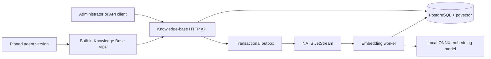

# Knowledge Base Microservice Specification

- **Status:** Implemented
- **Date:** 2026-11-19
- **Owner:** Agent Platform

## Purpose

The Knowledge Base microservice provides project-scoped document storage and retrieval for agents. A project may own zero or more knowledge bases, and a knowledge base may own zero or more documents. Documents are managed through HTTP. Their contents are split into overlapping chunks and embedded asynchronously by workers. PostgreSQL, with the `pgvector` extension, is the authoritative store for document metadata, chunks, embeddings, and indexing state.

The service exposes a built-in MCP server for permitted agent versions. Its search tool embeds a query locally and returns the ranked source chunks and their provenance. It does not return raw embedding vectors. This is intentionally not a direct database integration: the MCP server enforces project scope and explicit tool grants, then invokes the control-plane application layer.

## Goals

- Isolate every knowledge base and document to one project.
- Support durable CRUD of document text and metadata over HTTP.
- Index documents asynchronously so document writes are not coupled to model inference latency.
- Store chunk embeddings in PostgreSQL and make their generation and replacement idempotent.
- Let an authorised pinned agent version retrieve chunks only from knowledge bases in its own project.
- Preserve a useful audit trail for document versions, indexing attempts, and MCP retrievals.

## Non-goals for the first release

- Binary-file storage, OCR, format-specific extraction, web crawling, or connector synchronisation. The initial document payload is UTF-8 plain text.
- Cross-project sharing, public knowledge bases, or ACLs below the project boundary.
- Mutable embedding records. A re-index creates a new immutable document revision and replaces the revision's active chunk set atomically.
- User-provided SQL, arbitrary vector dimensions, or arbitrary embedding models/endpoints.
- A synchronous "wait until indexed" API.

## Architecture and ownership

The existing project remains the resource and authorisation boundary. The knowledge-base service is an independently deployable API and worker pair with its own PostgreSQL database. `project_id`, agent IDs, and grant IDs are opaque external references: the knowledge-base database has no foreign keys to platform-owned tables. The platform resolves ownership through an authenticated internal service API.



The ownership hierarchy is:

```text
Project
└── Knowledge base (zero or more)
    └── Document (zero or more; stable logical identity)
        └── Document revision (one active revision, retained history)
            └── Document chunk (zero or more embeddings)
```

`project_id` is stored on every knowledge-base-owned record as an isolation reference. All HTTP routes include the project ID. The service only uses foreign keys between its own records; a request for a resource outside the caller's project returns `404` rather than disclosing its existence.

## Components and responsibilities

| Component | Responsibilities | Must not do |
| --- | --- | --- |
| HTTP/control-plane API | Validate and authorise requests; persist business state and outbox intent in one transaction; return DTOs and problem details. | Run embedding inference or write vectors during a document request. |
| Outbox publisher | Publish recorded indexing commands to JetStream with stable IDs. | Invent or mutate document state. |
| Embedding worker | Consume commands idempotently; load the requested revision; chunk, embed, and commit results; record attempt outcomes. | Treat JetStream delivery as the source of truth or expose HTTP/MCP endpoints. |
| PostgreSQL + `pgvector` | Hold authoritative metadata, document content, chunks, vectors, and audit records. | Be accessed directly by an agent or browser. |
| Built-in Knowledge Base MCP server | Validate the calling pinned agent version and per-tool grant; delegate retrieval to the application layer. | Write directly to PostgreSQL, publish directly to NATS, or bypass project scope. |

## Embedding model and chunking policy

The first release uses **`BAAI/bge-small-en-v1.5`**, exported to ONNX and packaged as a versioned, checksum-verified application asset. It is an English retrieval model with 384-dimensional vectors and a 512-token sequence limit. It is small enough for CPU inference in a background worker while leaving a useful context margin for chunk text. The worker runs it in-process on .NET through `Microsoft.ML.OnnxRuntime`; no Python runtime, remote embedding API, or model-provider credential is required. The ONNX Runtime C# binding supports CPU inference on the service's Linux deployment target. [Model card](https://huggingface.co/BAAI/bge-small-en-v1.5) and [ONNX Runtime C# documentation](https://onnxruntime.ai/docs/get-started/with-csharp.html).

The model asset includes its matching tokenizer vocabulary/configuration. The worker must implement the model's exact tokenisation, attention-mask, pooling, and L2-normalisation contract in C#, and verify it against checked-in model-output test vectors before deployment. It must use the same model digest and preprocessing version for document and query embeddings.

Documents are chunked at **384 model tokens** with a **64-token overlap** (320-token stride). Boundaries should prefer paragraph and sentence breaks within a small token tolerance; when none is available, they split at the hard boundary. These sizes stay comfortably inside the model's 512-token maximum, preserve local context across boundaries, and avoid spending the entire context window on a single chunk. Empty chunks are discarded. The tokenizer—not character or word count—is authoritative.

## Data model

All IDs are UUIDs and timestamps are UTC. Deletion of a knowledge base or document is logical; text, chunks, and audit records are retained according to the platform retention policy and excluded from normal reads and retrieval.

### `knowledge_bases`

| Column | Notes |
| --- | --- |
| `id`, `project_id` | Primary key and required project ownership. |
| `name` | Required display name; unique among non-deleted knowledge bases in a project, case-insensitively. |
| `description` | Optional, maximum 4,000 characters. |
| `embedding_model` | Fixed for v1 to `BAAI/bge-small-en-v1.5` plus the deployed asset digest and preprocessing version. It produces 384 dimensions. |
| `chunk_size_tokens` | Fixed for v1 to 384 model tokens. |
| `chunk_overlap_tokens` | Fixed for v1 to 64 model tokens. |
| `status` | `Active`, `Deleting`, or `Deleted`. |
| `created_at`, `updated_at`, `deleted_at` | Audit/lifecycle timestamps. |
| `row_version` | Optimistic-concurrency token. |

Chunking and embedding settings are immutable once a document has been accepted. A future model upgrade creates a new versioned embedding profile and re-indexes a distinct knowledge base, which prevents a retrieval corpus from silently mixing incompatible models or chunking policies.

### `knowledge_base_documents`

| Column | Notes |
| --- | --- |
| `id`, `project_id`, `knowledge_base_id` | Identity, external project reference, and service-local knowledge-base foreign key. |
| `external_id` | Optional caller-supplied stable ID, unique per knowledge base when present. |
| `title` | Required, maximum 512 characters. |
| `metadata` | Validated JSON object, maximum 32 KiB; reserved keys beginning with `_` are rejected. |
| `active_revision_id` | The latest completely indexed revision eligible for retrieval; null until the first revision is ready. |
| `indexing_status` | `Pending`, `Indexing`, `Ready`, `Failed`, or `Deleted`. |
| `last_indexed_at`, `last_error_code`, `last_error_message` | User-visible status; errors are sanitised and never contain secrets or document bodies. |
| `created_at`, `updated_at`, `deleted_at`, `row_version` | Audit/lifecycle and optimistic concurrency. |

### `knowledge_base_document_revisions`

Each create or replacement creates a revision with a monotonically increasing `revision_number`. It contains `content` (plain UTF-8 text, initially capped at 10 MiB), `content_sha256`, `embedding_model`, chunking settings copied from the knowledge base, its status, and indexing attempt counts/timestamps. The content hash enables duplicate delivery detection and observability; it is not used to infer that unrelated documents may share data.

### `knowledge_base_document_chunks`

Each chunk belongs to exactly one revision and stores `chunk_index`, `token_start`, `token_end`, `text`, `content_sha256`, and `embedding vector(<configured dimension>)`. A unique key on `(document_revision_id, chunk_index)` makes chunk persistence idempotent. The schema also stores `project_id`, `knowledge_base_id`, and `document_id` for mandatory retrieval filters and efficient deletion.

Use a `pgvector` HNSW index over `embedding vector_cosine_ops`, plus B-tree indexes beginning with `project_id, knowledge_base_id` and the document/revision foreign keys. The migration must execute `CREATE EXTENSION IF NOT EXISTS vector`; local and production PostgreSQL images must include the matching `pgvector` extension. The current stock `postgres:17-alpine` image is insufficient until it is replaced or extended.

### Supporting records

- `knowledge_base_indexing_jobs`: stable `job_id`, revision ID, status, attempt number, correlation/causation IDs, lease fields, and sanitised failure details. It provides an auditable work record independent of a JetStream delivery.
- `outbox_messages`: uses the platform outbox with event type `knowledge_base.document.index.requested` and `job_id` as its idempotency/message identifier.
- `knowledge_base_retrieval_audit`: records the calling agent version/thread/run when available, requested knowledge-base IDs, result count, and timestamps. It records query hashes rather than query text by default.

## HTTP API

Base path: `/api/projects/{projectId}/knowledge-bases`. API requests require the platform's normal project authorisation. JSON uses camelCase. IDs are UUIDs and timestamps are ISO 8601 UTC. Validation errors use `400` problem details, missing or inaccessible resources use `404`, and an `If-Match` mismatch returns `412 Precondition Failed`.

### Knowledge bases

| Operation | Endpoint | Notes |
| --- | --- | --- |
| List | `GET /` | Supports `limit` (1–100) and opaque `cursor`; excludes deleted resources. |
| Create | `POST /` | Returns `201 Created` with `Location`. |
| Read | `GET /{knowledgeBaseId}` | Includes aggregate document/indexing counts. |
| Update metadata | `PATCH /{knowledgeBaseId}` | Requires `If-Match`; may change name and description only. |
| Delete | `DELETE /{knowledgeBaseId}` | Requires `If-Match`; returns `202 Accepted` while documents/chunks are logically retired and cleanup is queued. |

Example create request:

```json
{
  "name": "Product documentation",
  "description": "Approved product material for support agents."
}
```

### Documents

| Operation | Endpoint | Notes |
| --- | --- | --- |
| List | `GET /{knowledgeBaseId}/documents` | Cursor pagination; may filter by `indexingStatus`. Content is omitted. |
| Create | `POST /{knowledgeBaseId}/documents` | Creates a document and revision, queues indexing, returns `202 Accepted`. Supports `Idempotency-Key`. |
| Read metadata | `GET /{knowledgeBaseId}/documents/{documentId}` | Returns document metadata and indexing status; content is omitted by default. |
| Read source | `GET /{knowledgeBaseId}/documents/{documentId}/content` | Explicit endpoint for the active plain-text revision. |
| Replace content | `PUT /{knowledgeBaseId}/documents/{documentId}/content` | Requires `If-Match`; creates a revision and queues indexing, returns `202 Accepted`. |
| Update metadata | `PATCH /{knowledgeBaseId}/documents/{documentId}` | Requires `If-Match`; changes title/metadata only and does not re-embed. |
| Delete | `DELETE /{knowledgeBaseId}/documents/{documentId}` | Requires `If-Match`; logically deletes the document and makes its chunks unavailable immediately. |

A document create or replacement body is:

```json
{
  "title": "Refund policy",
  "externalId": "policy-refunds-v3",
  "content": "Plain UTF-8 source text ...",
  "metadata": {
    "source": "handbook",
    "locale": "en-GB"
  }
}
```

The `202` response includes a document summary, its new `revisionId`, `indexingStatus: "Pending"`, and `indexingJobId`. Accepted content is durable before the response is returned; a first revision is not retrievable until it is `Ready`. Updating a document while a prior revision is indexing supersedes the earlier job. A document becomes `Ready` only when the complete new chunk set is committed; its previous ready revision remains retrievable until then. Failed replacement indexing leaves the previous ready revision active, reports `Failed` for the attempted revision, and permits retry through `POST /{knowledgeBaseId}/documents/{documentId}/indexing-jobs/{jobId}/retry`.

## Indexing workflow and delivery guarantees

1. The API validates the project, knowledge-base status, content size, metadata, concurrency token, and idempotency key.
2. In one PostgreSQL transaction it persists the document revision, indexing job, document state, and an outbox message containing `jobId`, `projectId`, `knowledgeBaseId`, `documentId`, `revisionId`, schema version, and correlation IDs.
3. The outbox publisher sends the message to `agent-platform.project.{projectId}.knowledge-base.index.requested` with `Nats-Msg-Id` equal to `jobId`.
4. A durable pull consumer delivers the command to one embedding worker. Workers may receive it more than once.
5. The worker claims the job transactionally. If the job is complete, superseded, deleted, or leased by a live attempt, it performs no model work and safely acknowledges the message.
6. The worker tokenises and deterministically chunks the revision. Adjacent chunks overlap by the configured number of tokens; zero-length chunks are never written. Chunk order, tokenizer version, model ID, and chunking settings are recorded with the revision.
7. The worker sends bounded batches to the local ONNX inference session, verifies every normalised vector has 384 finite dimensions, then writes the complete new chunk set and marks the revision/job ready in one transaction. Only then does it acknowledge JetStream.
8. Transient database/resource failures are recorded durably and left unacknowledged or negatively acknowledged with bounded backoff. Permanent validation or model-asset failures mark the job/revision `Failed` and are acknowledged because retry cannot succeed without a new command or correction.

The worker must use cancellation tokens for external calls. It must never log source content, embeddings, API keys, or raw model inputs/outputs. Retry policy, batch size, lease duration, maximum attempts, and rate limits are configuration values with safe defaults and metrics.

## MCP interface

The service registers a built-in platform MCP server named `knowledge-base`. It is globally operated but scope derives exclusively from the calling pinned agent version. Like every built-in MCP tool, it is deny-by-default: an agent version needs an explicit grant for the named tool. The server delegates all work to the control-plane application layer.

### Tool: `knowledge_base.search`

This tool embeds a text query locally and returns the most relevant source chunks. It is the first-release retrieval interface for agent runtimes; it does not disclose raw embedding vectors or data from another project.

Input schema:

```json
{
  "knowledgeBaseIds": ["uuid"],
  "query": "When can a customer request a refund?",
  "limit": 10,
  "minimumSimilarity": 0.65,
  "metadataFilter": { "locale": "en-GB" }
}
```

- `knowledgeBaseIds` must contain 1–20 unique knowledge bases in the caller's project.
- `query` is required plain text, limited to 2,000 characters and tokenised/truncated to 128 model tokens. It is embedded by the same local model, asset digest, and preprocessing contract as document chunks.
- `limit` is 1–50, default 10. `minimumSimilarity` is optional and constrained to `[-1, 1]`.
- `metadataFilter` is an equality-only object with a bounded depth and size; it is translated through parameterised queries only.

Success result:

```json
{
  "results": [
    {
      "knowledgeBaseId": "...",
      "documentId": "...",
      "documentTitle": "Refund policy",
      "revisionId": "...",
      "chunkIndex": 3,
      "text": "...",
      "similarity": 0.91,
      "metadata": { "source": "handbook", "locale": "en-GB" }
    }
  ]
}
```

The service embeds the query in-process, then filters on project ID, requested active knowledge bases, non-deleted documents, and active ready revisions before applying vector similarity. It uses cosine similarity (`1 - cosine_distance`), ranks descending, and applies `minimumSimilarity` after calculating the score. It returns a stable deterministic tie-breaker such as document ID then chunk index. Empty results are successful. The tool records a retrieval audit event but does not persist the query text or vector.

No generic MCP tool may list all projects, enumerate another project's knowledge bases, retrieve raw document contents without an explicit knowledge-base ID, or mutate documents in the first release.

## Security, privacy, and operations

- Enforce project authorisation at HTTP and application-service boundaries. The browser never connects to PostgreSQL, NATS, or the local model runtime.
- Treat document content, chunks, embeddings, and retrieval outputs as potentially sensitive. Redact them from application logs, tracing attributes, exception details, and routine audit records.
- Package and checksum-pin model/tokenizer assets at image build or deployment time; workers must not download or replace model assets at runtime.
- Apply request-size limits, text/metadata validation, inference timeouts, per-project concurrency limits, and rate limits to protect the service and its hosts.
- Publish metrics for pending/indexing/ready/failed jobs, indexing duration, queue age, retries, chunk count, inference latency/errors, retrieval latency, and vector-index health. Alerts should cover a growing queue age and repeated terminal failures.
- Back up PostgreSQL as the authoritative source. Vector indexes are derived from rows and may be rebuilt; document revisions remain the source for re-embedding after a model migration.
- Database migrations create tables, constraints, the `vector` extension, and indexes. Deployment must fail early if the extension/image version is unavailable or the configured model dimension conflicts with the schema.

## Acceptance criteria

- A project can create, list, read, update, and logically delete zero or more knowledge bases, while another project cannot discover them.
- A knowledge base can create, list, read, replace, update, and logically delete zero or more documents through the documented HTTP API.
- Creating or replacing a document commits the source revision and an outbox intent atomically, responds without waiting for embeddings, and exposes durable indexing status.
- Duplicate JetStream delivery or a worker restart does not create duplicate chunks, corrupt active revisions, or run inference after a completed job is recognised.
- Chunk boundaries honour the configured token overlap, and vectors are persisted only when their model and dimensions validate.
- Deleted/superseded documents and incomplete revisions are excluded from MCP retrieval immediately; a failed replacement retains the prior ready revision.
- An agent version without an explicit `knowledge_base.search` grant is denied. A granted version receives only chunks from explicitly requested knowledge bases in its own project.
- MCP search returns chunk text, provenance, similarity, and metadata, with deterministic ordering and bounded result sizes; raw embeddings never leave the service.
- Schema changes are delivered through migrations, and unit/integration tests cover ownership, transitions, idempotency, outbox publication, JetStream redelivery, and pgvector retrieval filtering.

## Open decisions

- Confirm the licensing review and operational resource limits for the pinned `BAAI/bge-small-en-v1.5` ONNX model asset.
- Set production document-size, chunk-count, retry, and retention limits from expected workload and cost budgets.
- Decide whether binary/blob content should later live in object storage with extracted text retained as a revision, or whether plain text remains the contract.
