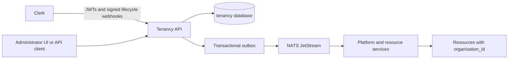

# Tenancy Microservice Specification

- **Status:** Proposed
- **Date:** 2026-11-21
- **Owner:** Agent Platform

## Purpose

The Tenancy microservice owns the platform’s durable Clerk-account directory and organisation membership. It manages named organisations with one owner account and optional member accounts.

Other systems own their resources and persist an organisation reference on those resources. This service does not register, discover, validate, or store resource associations. Clerk remains the identity provider; this service turns a validated Clerk subject into a durable platform account and owns account lifecycle, platform-administrator designation, organisation membership, and access decisions.

## Goals

- Maintain an auditable account projection keyed by Clerk user ID.
- Create, list, read, update, transfer, and logically delete organisations.
- Store a required name, optional description, and exactly one owner account.
- Grant and revoke organisation membership for accounts.
- Provide internal account-resolution and organisation-access decisions.
- Publish durable account and membership lifecycle events.
- Use its own database on the existing PostgreSQL container.

## Non-goals for v1

- Owning, listing, validating, or associating arbitrary resources.
- Writing an `organisation_id` to a resource service’s data store, or enforcing resource-specific permissions.
- Password management, email verification, invitations, nested organisations, billing, quotas, or public organisations.
- Generic organisation roles: v1 has an owner and members.
- Direct browser, agent, or external-service database access.

## Architecture and ownership

The service is independently deployable: an HTTP/control-plane API, Clerk webhook receiver, and transactional-outbox publisher backed by a `tenancy` database on the existing `postgres` container. The shared PostgreSQL server is infrastructure only; the database is a service-ownership boundary.



A resource service persists an `organisation_id` reference for its own resource, retains authority over the resource and its permissions, and verifies the organisation is active. It may ask this service for an account access decision. There are no resource tables, resource routes, resource adapters, or cross-database foreign keys here.

## Account domain

An **account** is a local durable projection of one Clerk user, not a credential. Clerk’s immutable user ID is `clerk_user_id`; the account UUID is the stable internal platform ID used by memberships and other services.

On a successful Clerk-authenticated request, the service ensures an account exists and updates `last_seen_at`. The token’s validated `sub` is the sole caller identity; browser input cannot select the actor. Verified Clerk lifecycle webhooks upsert safe display fields. Webhook processing is idempotent on Clerk event ID.

For `user.deleted`, the account becomes deleted, loses effective membership, and cannot own an active organisation. Each owned organisation must be transferred to an active member or logically deleted through a resumable workflow. Email and profile data are optional display fields, never identity or authorisation keys.

The platform-administrator flag is an account-level designation owned by this service. Initial bootstrap Clerk IDs are configured only on the service. On first observation they are created as administrators. An administrator may change the flag, but the last active administrator cannot be removed.

## Organisation domain rules

```text
Account (one Clerk user)
├── may own organisations
└── may belong to organisations

Organisation
├── owner account (exactly one)
├── member accounts (zero or more, excluding owner)
└── immutable audit events
```

1. Every active organisation has exactly one active owner.
2. The owner has full organisation-management rights and is not duplicated as a member row.
3. A member has `Member` access: it may view its organisation but cannot change metadata, membership, ownership, or lifecycle.
4. Only the owner may manage the organisation.
5. An account has at most one active membership in an organisation.
6. Deleting/deleted organisations grant no effective membership access.
7. IDs are UUIDs, timestamps are UTC, and mutable records use optimistic concurrency.

An internal decision for `(organisationId, accountId)` returns `Owner`, `Member`, or `None`, plus an access revision. A resource service uses it only after confirming that its own resource references the requested organisation.

## Data model

All tables belong to the `tenancy` database. Migrations create only local foreign keys, constraints, partial unique indexes, and outbox indexes.

### `accounts`

| Column | Notes |
| --- | --- |
| `id` | UUID primary key; the platform account ID. |
| `clerk_user_id` | Required immutable Clerk subject; unique, trimmed, maximum 255 characters. |
| `display_name`, `primary_email` | Nullable Clerk-projected display fields; not used for identity or authorisation. |
| `is_platform_administrator` | Global administrator designation. |
| `status` | `Active`, `Deleted`, or `Blocked`. |
| `created_at`, `updated_at`, `last_seen_at`, `deleted_at` | UTC audit/lifecycle timestamps. |
| `row_version` | PostgreSQL optimistic-concurrency token. |

No password, raw JWT, webhook signature, or credential is stored. An audit reference to Clerk stores only event ID and event type.

### `organisations`

| Column | Notes |
| --- | --- |
| `id` | UUID primary key. |
| `name` | Required display name, trimmed, 1–256 characters; unique case-insensitively among non-deleted organisations. |
| `description` | Nullable, maximum 4,000 characters. |
| `owner_account_id` | Required local foreign key to `accounts`. |
| `access_revision` | Increments on ownership/membership changes. |
| `status` | `Active`, `Deleting`, or `Deleted`. |
| `created_at`, `updated_at`, `deleted_at` | UTC lifecycle timestamps. |
| `row_version` | Optimistic-concurrency token. |

### `organisation_members`

| Column | Notes |
| --- | --- |
| `id`, `organisation_id`, `account_id` | UUID identity and local foreign keys. |
| `role` | Fixed to `Member` in v1; retained for compatible future expansion. |
| `status` | `Active` or `Revoked`. |
| `granted_by_account_id`, `granted_at` | Grant audit fields. |
| `revoked_by_account_id`, `revoked_at` | Revocation audit fields. |
| `row_version` | Optimistic-concurrency token. |

A partial unique index on active `(organisation_id, account_id)` prevents duplicate membership. Constraints and application validation prevent an owner also being an active member.

### Audit, idempotency, and outbox

`organisation_audit_events` is append-only: event ID, organisation ID when relevant, event type, actor account/internal identity, timestamp, correlation/causation IDs, and sanitised change payload.

`idempotency_records` stores actor, endpoint, idempotency key, request hash, completed response, and expiry. Reusing a key with different input returns `409 Conflict`.

`outbox_messages` is inserted atomically with each externally meaningful change. It contains stable event ID, type, schema version, subject, payload, publication attempt fields, and publication time. The event ID is the JetStream `Nats-Msg-Id`.

## HTTP API

Base path: `/api`; JSON is camelCase. Browser-facing routes require a validated Clerk session. The acting account derives from token `sub`, not client input.

Validation returns `400`; unauthenticated is `401`; insufficient permission is `403`; unknown/inaccessible organisations are `404`; conflicts are `409`; and an `If-Match` mismatch is `412 Precondition Failed`.

### Organisation routes

Base path: `/api/organisations`.

| Operation | Endpoint | Notes |
| --- | --- | --- |
| List accessible | `GET /` | Cursor pagination, limit 1–100; owned and shared organisations. |
| Create | `POST /` | Authenticated account becomes owner; `201 Created`. |
| Read | `GET /{organisationId}` | Owner sees members; member sees metadata. |
| Update | `PATCH /{organisationId}` | Owner only; name/description; requires `If-Match`. |
| Delete | `DELETE /{organisationId}` | Owner only; requires `If-Match`; `202 Accepted`. |
| Transfer ownership | `POST /{organisationId}/ownership-transfers` | Target active member; owner only; requires `If-Match`. |
| List members | `GET /{organisationId}/members` | Owner only; cursor pagination. |
| Grant membership | `POST /{organisationId}/members` | Owner only; `201 Created`. |
| Revoke membership | `DELETE /{organisationId}/members/{accountId}` | Owner only; requires `If-Match`; cannot revoke owner. |

Create body:

```json
{
  "name": "Acme Research",
  "description": "Accounts collaborating on Acme research."
}
```

Membership grant body:

```json
{ "accountId": "a3c80709-9d4d-4e68-b42f-d7279ed2047d" }
```

Responses include an ETag derived from `rowVersion`. Mutations require `If-Match`; membership grants and ownership transfer also accept an `Idempotency-Key`, retained for at least 24 hours.

### Account administration routes

All are platform-administrator-only except `GET /api/accounts/me`.

| Operation | Endpoint | Notes |
| --- | --- | --- |
| Current account | `GET /api/accounts/me` | Caller’s local account projection. |
| List accounts | `GET /api/accounts` | Cursor pagination and status filter. |
| Read account | `GET /api/accounts/{accountId}` | Metadata and organisation summary. |
| Set administrator | `PUT /api/accounts/{accountId}/platform-administrator` | Body: `{ "isAdmin": true | false }`; cannot remove last active admin. |

The service does not create an account from arbitrary input: sign-in or verified Clerk webhook events create it.

### Internal routes

These are workload-authenticated and never browser-proxied.

| Operation | Endpoint | Notes |
| --- | --- | --- |
| Resolve account | `POST /internal/accounts/resolve` | Clerk user ID to active platform account ID. |
| Access decision | `POST /internal/organisation-access-decisions` | Organisation/account IDs to role, access revision, and cache expiry. |
| Organisation lookup | `POST /internal/organisations/lookup` | Organisation ID to status and revision. |

Consumers cache only to the supplied expiry/revision, invalidate on newer events, and fail closed when an authorisation decision is necessary.

## Workflows and consistency

Every mutation validates authorisation/input and writes business state, audit data, and outbox intent in one PostgreSQL transaction before response.

Authenticated traffic makes the account activity upsert transactionally consistent with its requested operation. Clerk lifecycle webhook handling is idempotent by Clerk event ID; a stale event cannot revive a deleted account.

Granting membership requires an active target, applies the unique constraint, increments `access_revision`, and emits an event. Revocation becomes authoritative before event publication. Consumers whose projections may be stale must recheck the decision API for sensitive operations.

Ownership transfer atomically assigns the active member target as owner, revokes their member row, creates an active member row for the former owner, increments access revision, and publishes a transfer event.

Account deletion/blocking immediately removes effective access and revokes memberships. Owned organisations are transferred to a designated active member or moved to `Deleting` and logically deleted by a resumable auditable workflow.

Organisation deletion moves it to `Deleting`, makes all access decisions `None`, revokes active members, and publishes `organisation.deleting`. It becomes `Deleted` only after the durable workflow finishes. Resource services decide independently how their references are handled.

## Event contract

Organisation events use `agent-platform.organisation.{organisationId}.events`; account events use `agent-platform.account.{accountId}.events`. Envelopes contain `eventId`, `eventType`, `schemaVersion`, `occurredAt`, `correlationId`, `causationId`, and `data`, plus organisation or account ID.

Initial types:

- `account.created`
- `account.updated`
- `account.deleted`
- `account.platform_administrator.changed`
- `organisation.created`
- `organisation.updated`
- `organisation.member.granted`
- `organisation.member.revoked`
- `organisation.owner.transferred`
- `organisation.deleting`
- `organisation.deleted`

The outbox publisher retries until successful and uses event ID for JetStream deduplication. Consumers use durable pull consumers, persist processed event IDs or revisions, and acknowledge only after durable local work. Delivery is at-least-once and replayable, so consumers must be idempotent. Events contain no Clerk credentials or tokens.

## Security and operations

- Validate Clerk JWTs against the configured issuer/audience; verify Clerk webhook signatures before parsing/persisting lifecycle events.
- Never log raw JWTs, webhook secrets/signatures, credentials, or unredacted profile data.
- Apply request-size limits, rate limits, parameterised persistence, and bounded downstream calls.
- Browser clients never connect to PostgreSQL/NATS; internal routes require least-privilege workload authentication.
- Back up the database independently, including audit and outbox data.
- Measure webhook outcomes/lag, accounts, membership changes, decision latency/errors, outbox age, event lag, and deletion workflow duration/failures. Alert on signature failures, growing outbox, and blocked deletion.

## Deployment and migration

```dotenv
TENANCY_POSTGRES_DB=tenancy
TENANCY_CONNECTION_STRING=Host=postgres;Port=5432;Database=tenancy;Username=agent;Password=<secret>
```

Docker Compose adds a `tenancy-database-bootstrap` one-shot container. It waits for the existing `postgres` health check and creates the database only when absent. The API depends on that completion and applies EF Core migrations only to `tenancy`; it must not add tables to `agent_platform`, `knowledge_base`, or another service database.

Move the existing platform `accounts` table with a staged cutover:

1. Deploy this service with account schema, Clerk webhook processing, and internal account resolution.
2. Backfill current platform accounts, preserving UUIDs, Clerk user IDs, administrator flags, and timestamps.
3. Move the platform API and admin UI to this service’s account APIs/internal decisions.
4. Verify parity, stop writes to the old store, then remove platform account persistence through a migration.

## Acceptance criteria

- A validated Clerk subject produces one idempotent active account projection.
- The account directory, administrator flag, and organisation membership reside only in this dedicated database after migration.
- Creating an organisation makes the caller sole owner; owners can grant/revoke active accounts.
- Ownership transfer is atomic and leaves exactly one owner, with the prior owner retained as a member.
- Deleted/blocked accounts lose access and cannot leave an active organisation ownerless.
- Other systems own resource references; this service stores no resource association.
- Meaningful mutations atomically create audit/outbox records; consumers handle JetStream redelivery safely.
- Migrations and tests cover Clerk verification/idempotency, account migration, access rules, ownership transfer, concurrency, outbox atomicity, redelivery, and deletion recovery.

## Open decisions

- Required Clerk webhook event set and the profile fields retained beyond display name/primary email.
- User experience for organisation transfer before a Clerk account is deleted.
- Whether platform-administrator designation remains here long term or later moves to a dedicated authorisation service.
- Per-resource-service choice between live access decisions, event-fed projections, or both.

